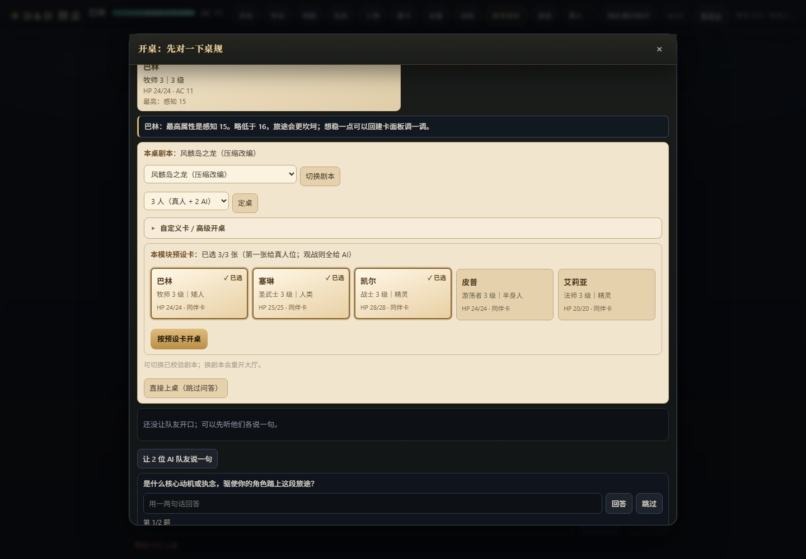
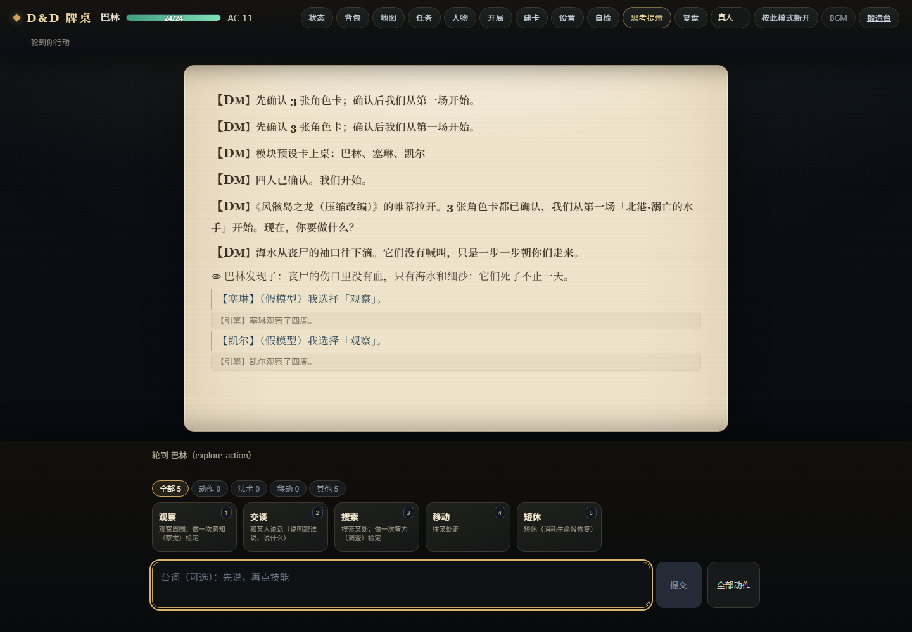
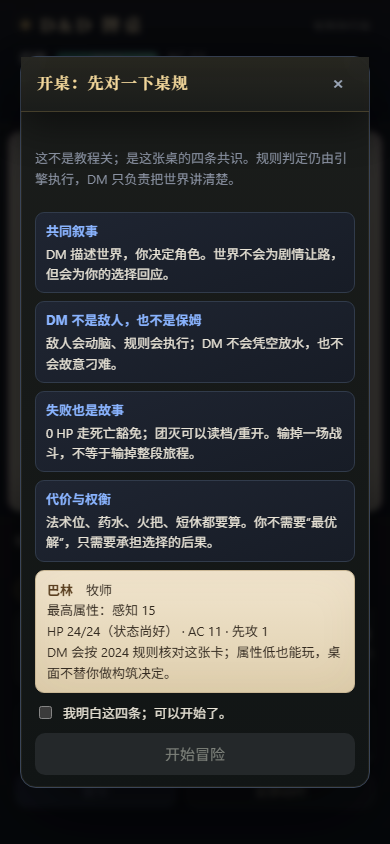

# D&D AI 跑团（dnd-ai-table）

一个**在本地跑**的 AI 跑团桌面：**1 个 DM + 1~5 名玩家**（真人 1 名 + 0~4 名 AI），
规则数值由引擎算，模型只负责「出意图」和「写叙事」。

网页开局大厅可以定桌、建卡（手搓 / 卡库选卡 / 8 问生成）、换剧本、生成 AI 同伴、审卡并上桌；
桌上能打、能查、能存读档、能复盘，也能观战和托管。



| 桌面 | 手机 |
|---|---|
|  |  |

---

## 这个项目想解决什么

大多数「AI 跑团」的失败点不是模型不够聪明，而是**让它算规则**：

- 它会把 AC 算错、把伤害算错、把先攻顺序搞乱；
- 它会在你 HP 只剩 3 的时候说「你轻松躲开」；
- 它记不住三场之前埋的伏笔，也分不清谁知道什么。

所以这里的做法是：**规则归引擎，叙事归模型**。

```text
玩家输入 → 引擎解析意图 → 掷骰/命中/伤害/豁免全部由代码结算
        → 只把「结算结果 + 可见上下文」交给模型 → 模型写一段叙事
        → 引擎校验叙事有没有编造数值 → 写回状态
```

模型的输出**不能**直接改数值。它说「你受到 12 点伤害」不算数，引擎算出来才算数。

---

## 现在能跑到哪一步

**已经跑通（假模型，零 API 花费）**

- 全量回归脚本 `tests/run_all.py` 全绿（86 个脚本，见下方「测试」）；
- 网页开局大厅全流程：定桌 → 建卡/选卡/8 问生成 → 选剧本 → 生成 AI 同伴 → 审卡 → 上桌；
- 一局完整短剧本能跑完：探索、社交、战斗、线索、收尾；
- 存读档、检查点、复盘（含思考链）、观战/托管/接管。

**真模型验证到哪**

- 单模型（`deepseek-v4.1-flash`）跑完《哨塔的拖痕》3/3，战斗清场并有收尾；
- 5 人桌（1 真人 + 4 个不同模型）跑到 5/5，但**不是干净的一局**：部分调用失败
  （模型侧温度参数被拒、内容过滤拒答、推理预算不足），结局不完整；
- 内容过滤、更长剧本、真人手点、读屏与手机端仍是**未验证**项。

**说人话**：这是一份能玩、能改、但还没「打磨到可以闭眼交付」的实现。
假模型路径是稳的；真模型路径取决于你接的模型脾气。

---

## 快速开始

需要 Python 3.11+（本机用 3.14 跑）。**不需要**任何第三方服务，假模型全程离线。

```powershell
cd dnd-ai-table

# 1) 全量回归（零模型花费，约 35~55 秒）
python tests\run_all.py

# 2) 网页开局大厅（假模型，零花费）
python -m engine.demo_web --session-zero

# 3) 想直接 1 真人 + 2 AI
python -m engine.demo_web --session-zero --ai-count 2

# 4) 终端跑完整短剧本
python -m engine.demo_table
```

浏览器打开：

```text
http://127.0.0.1:8770/
```

### 接真模型（要花自己的钱）

1. 复制 `tools/seat-config.example.json` 到**仓库外**，改成自己的座位配置；
2. `api_key_env` 只写**环境变量名**，key 放环境变量，**不要**写进仓库；
3. 启动时显式加 `--real`，并用 `--max-calls` 设一个硬闸：

```powershell
python -m engine.demo_web --real --session-zero `
  --ai-count 2 `
  --seat-config ..\my-seats.json `
  --max-calls 40 `
  --characters-dir ..\my-cards
```

注意：

- Claude 类接口必须 `"temperature": null`，否则上游直接 400；
- `reasoning_effort` 不填 / `null` 表示不发这个字段；
- 接入点 ID 是**各账号自己的资源**，不要照抄别人的配置。

---

## 目录结构

| 目录 | 放什么 |
|---|---|
| `engine/` | 规则引擎、战斗、状态、记忆、模型客户端、网页服务 |
| `engine/srd/` | SRD 5.2 数据（能力/法术/怪物/装备…），由 `fetch.py` 拉取 |
| `engine/rules/` | 判定、效果、装备、经济、线索、伏笔、叙事检查 |
| `engine/adventure/` | 剧本模型、战役编排、日志、进度 |
| `adventures/` | 剧本与战役 JSON（原创短剧本 + 测试本） |
| `tests/` | 86 个回归脚本 + `run_all.py` 运行器 |
| `tools/` | 真模型探针、复盘工具、剧本锻造台、座位配置示例 |
| `docs/` | 接手文档（见下） |
| `analysis/` | 少量设计图与成本脚本（不是开发日志） |

---

## 设计红线

这几条是这个项目**故意**做的取舍，改之前请先读 [10-机制事实](docs/10-机制事实.md)：

1. **骰子和数值由引擎算**，模型只出意图与叙事。不要用模型口胡替代掷骰与判定。
2. **世界书只给框架**。DM 现造的 NPC/地点写进当局存档，新开一局不保留。
3. **不做「任务完成 → 机械发奖表」**。收获来自剧情赠与、缴获、后果。
4. **模型可见性严格隔离**：DM 的秘密、别人的私有笔记，PC 和规划器拿不到。
5. **真模型调用是付费的**，默认关闭，必须显式开启并设调用上限。

---

## 文档地图

| 文档 | 回答什么 |
|---|---|
| [00-现状](docs/00-现状.md) | 当前能力、边界、明确没做的 |
| [10-机制事实](docs/10-机制事实.md) | **改代码前必读**：铁律、状态与可见性、结算顺序、代码地图 |
| [12-开发排障](docs/12-开发排障.md) | 模型调度、环境、踩过的坑、回归地图 |
| [20-变更日志](docs/20-变更日志.md) | 什么时候改了什么 |
| [30-决策记录](docs/30-决策记录.md) | 为什么这么设计（ADR） |
| [47-剧本导入工具](docs/47-剧本导入工具.md) | 把外部剧本转成本项目 JSON |
| [48-提示词注入与审核拒答](docs/48-提示词注入与审核拒答.md) | 注入、审核、拒答链路 |
| [49-常驻提示词](docs/49-常驻提示词.md) | DM / 玩家 / 检查三份系统提示词原文与理由 |
| [50-观战托管与BGM](docs/50-观战托管与BGM.md) | 观战、托管、接管、BGM |
| [52-开局与游玩测试](docs/52-开局与游玩测试.md) | 现在能不能开一局、真假模型各自验到哪 |
| [53-剧本四要素](docs/53-剧本四要素.md) | 新剧本要写的四个字段与注入边界 |
| [56-前端视觉v3](docs/56-前端视觉v3.md) | 纸页/桌面主题、卡面、地图与移动端边界 |
| [DM结构化设定协议](docs/DM结构化设定协议.md) | DM 造物字段、装备边界 |
| [验收-叙事与真机](docs/验收-叙事与真机.md) | 叙事抽样 + 读屏/真机验收单（真人部分未执行） |

> 公开版**不包含**个人开发看板与第三方材料：待办台账、问题台账、剧本覆盖矩阵、
> 旧视觉稿、外部审查报告、真模型逐调用 trace、以及读书笔记式的可行性分析。
> 这些不是「藏着」，而是它们对使用者没有价值，且混着别人的东西。

---

## 测试

```powershell
python tests\run_all.py            # 全部（86 个脚本）
python tests\run_all.py t_combat   # 只跑名字里带 t_combat 的
```

运行器会装一个**出口闸**：测试期间任何外连一律抛错，用来自证「测试真的离线、没偷偷调模型」。
要临时关掉用 `--no-netguard`。

每个脚本自己打印项数与失败数，退出码非 0 即为失败。

---

## 许可

本项目采用 **「源码可见 + 有限授权」**，不是 OSI 意义上的开源协议：

- ✅ 可以阅读、学习、研究、在自己设备上玩、私下修改、备份；
- ❌ 不可以商用（含闭源商用）、不可以对外分发（含二次开源/二次发布）、不可以再许可。

完整条款见 [LICENSE](LICENSE)。需要商用或分发请先取得作者书面授权。

### 第三方材料

- **SRD 5.2 数据**（`engine/srd/data/`）：来自 Wizards of the Coast 的系统参考文档，
  按 CC-BY-4.0 使用，署名与链接见 [NOTICE](NOTICE)。这部分**不受**本项目 LICENSE 约束。
- **D&D / Dungeons & Dragons 是 Wizards of the Coast 的商标**。本项目是非官方粉丝作品，
  与 WotC 无关联、未获其背书。仓库名刻意不使用该商标。
- 官方模组与第三方角色卡、预设**不随仓库分发**。