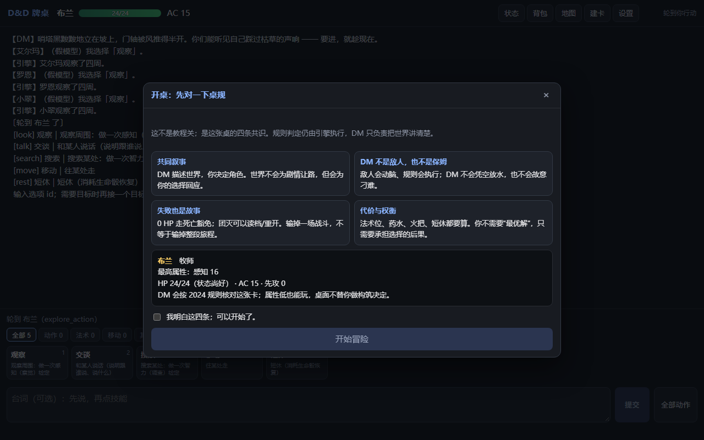
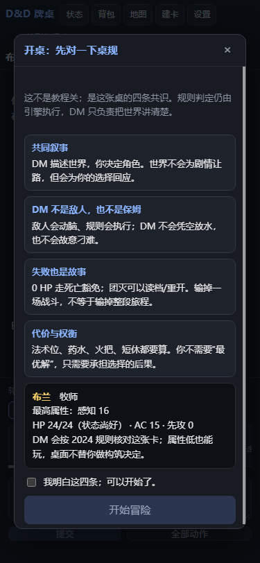
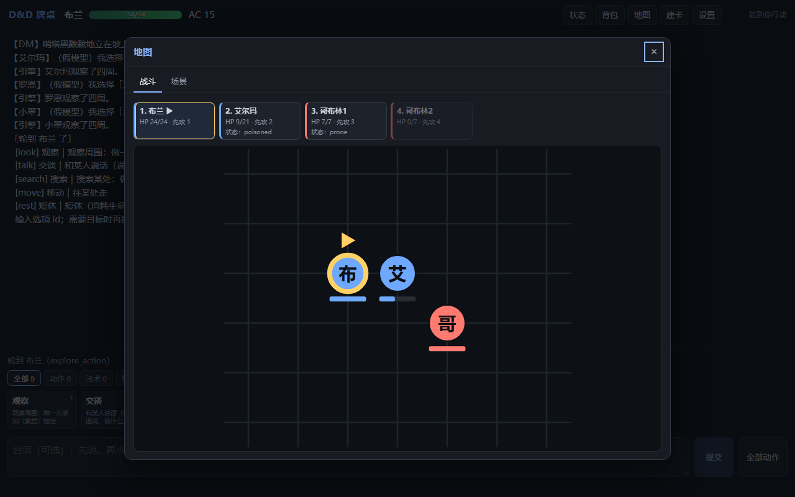
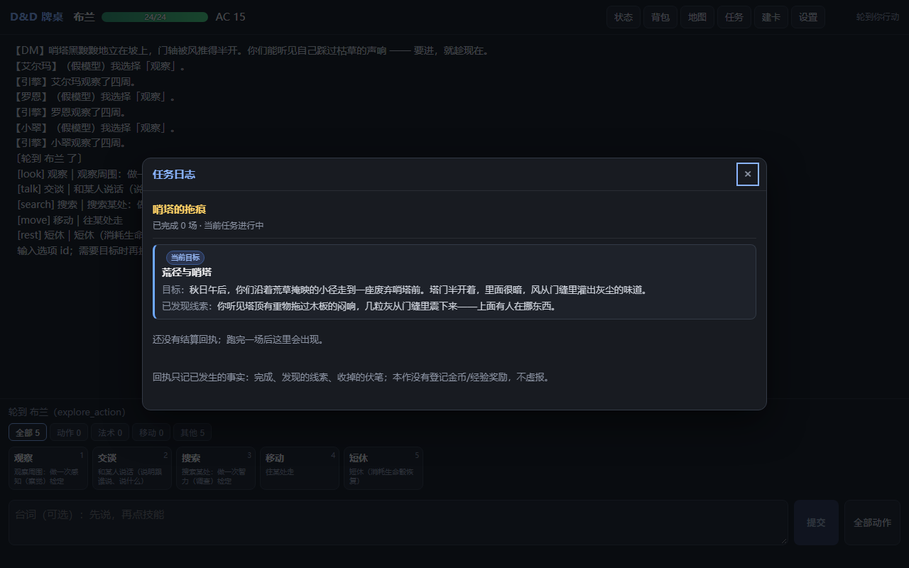
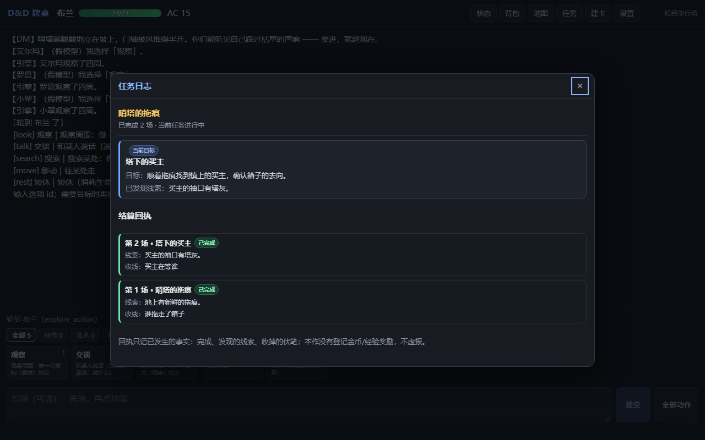
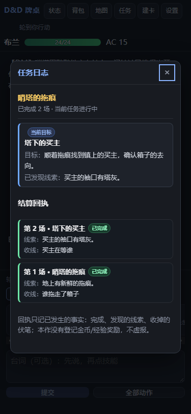
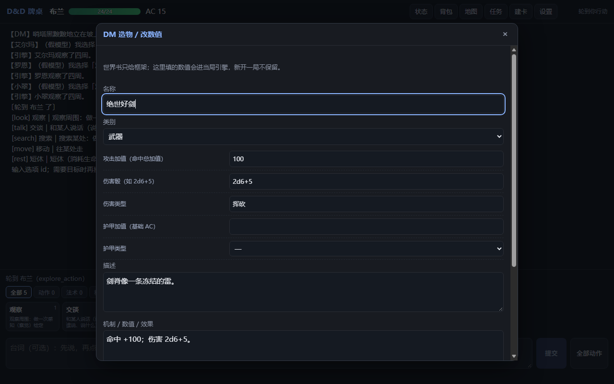
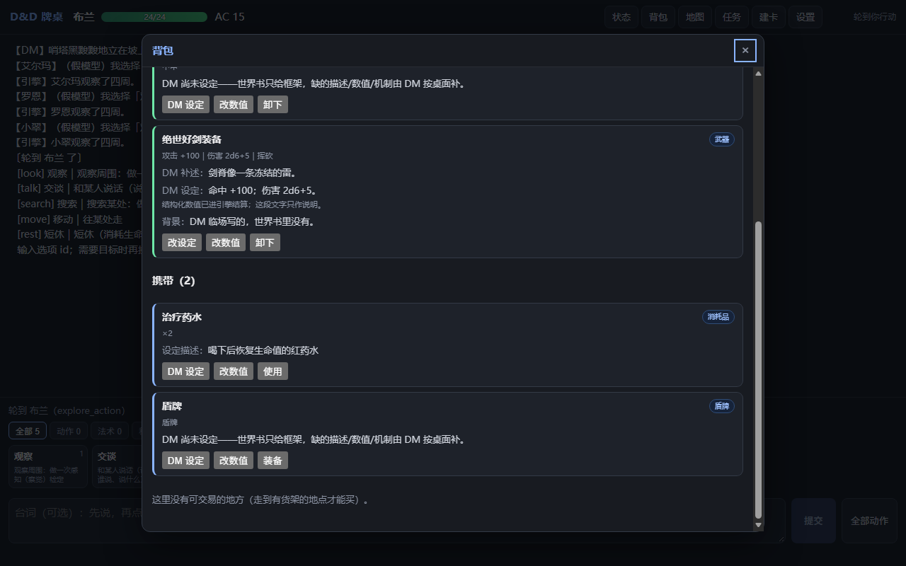
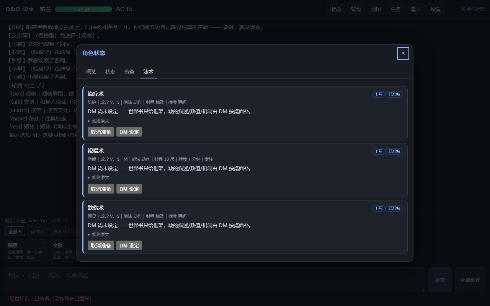
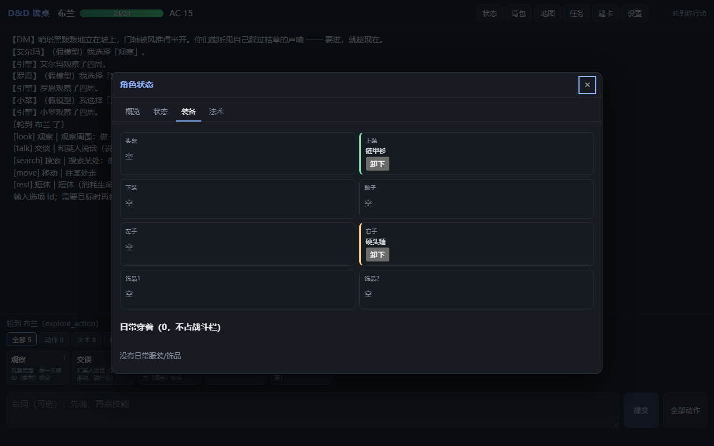

# 验收：叙事离线抽样 + 真机/读屏

> 状态：**自动化部分已跑；真人部分未执行，一律标"未验证"。**
> 2026-11-06 已用 Edge headless + CDP 设备模拟看两档宽度：
> `docs/验收截图/牌桌-1280.png`、`docs/验收截图/牌桌-375.png`（375 是真实视口，
> 不是把桌面页裁成 375）。这次截图**查出一个窄屏裁切问题**，已修（见 B4 注）。
> 这份单子分两半：能做机器的（A 的一半、B 的语义）已经进 `tests/`；
> 必须人做的（听读屏、真手机、肉眼判断文笔）留空，做完签字。
> 口径：文件里有步骤 ≠ 验过；只有下表填了"通过"并签字才算。

---

## A. 叙事质量离线抽样（U9 的零成本部分）

### A1. 机器能判的硬伤

```powershell
python tools\narrative_sample.py
python tests\t_narrate.py
```

覆盖：空/过短/过长、代码围栏、AI 自我暴露、骰面/DC、内部编号
（AM/选项/单位）、未发现秘密原文、复读同一句。
**不覆盖**：文笔、画面感、人物一致性、节奏 —— 这些下面人读。

### A2. 人读抽样（未执行）

同一套提示词/模型配置，抽 5 段 DM 叙事，按 1–5 打分：

| 编号 | 场景具体（不是空话） | 行动有后果 | NPC 有动机 | 无复读/套话 | 节奏 | 备注 |
|---|---|---|---|---|---|---|
| 1 | | | | | | |
| 2 | | | | | | |
| 3 | | | | | | |
| 4 | | | | | | |
| 5 | | | | | | |

- 抽样来源：真实一局的前 5 次 DM 叙事（不是手写样本）；
- 通过线：五项平均 ≥ 3.5，且没有单项 ≤ 2；
- 记录：模型名/提示词版本/日期；**没有真模型就填"未验证"**。

---

## B. 真机 / 读屏验收（真人执行）

### B0. 环境与边界

- 桌面实机：Windows 11 + Edge/Chrome，1280×800；另做 375×812 的设备模拟；
- 缩放：浏览器 200%（Ctrl + 加号到 200%）再走一遍首屏与弹层；
- **手机真机：当前服务只绑 `127.0.0.1` 且 Host 白名单只认本机**，
  手机连不上；要真机必须改绑定/白名单（安全边界，需单独授权）。
  因此手机真机一栏只能填"未验证/不支持"，不要假装过了。

### B1. 只用键盘（不碰鼠标）

| # | 操作 | 预期 | 结果 |
|---|---|---|---|
| 1 | Tab 从地址栏进入页面 | 焦点依次到工具栏按钮、日志、台词框、提交 | 未验证 |
| 2 | 数字 1–0 | 选中对应动作/选项，视觉有选中态 | 未验证 |
| 3 | Enter | 提交当前选择（输入框内除外） | 未验证 |
| 4 | 打开「状态」 | 焦点进入弹层第一项，读屏报"角色状态 对话框" | 未验证 |
| 5 | 弹层内 Tab / Shift+Tab | 焦点在弹层内循环，不跑到背后页面 | 未验证 |
| 6 | Esc | 弹层关闭，焦点回到「状态」按钮 | 未验证 |
| 7 | 存 1 / 读 1 / 下载 / 导入 | 都有明确反馈，错误用红字+播报 | 未验证 |

### B2. Windows Narrator

`Win + Ctrl + Enter` 打开讲述人，然后：

1. 听首屏：品牌、状态行、HUD、日志是否按顺序读出，不念"div/空白"；
2. 打开「状态」「背包」「地图」「建卡」「设置」：是否报出对话框名；
3. 在日志更新一轮后：是否自动播报新增行（`role="log"`）；
4. 触发一次错误（如导入坏档）：是否立即播报（`role="alert"`）；
5. 按钮是否都有名字（不应出现"按钮"或"times"）。

### B3. NVDA（可选）

同 B2 走一遍；重点听：对话框名、按钮名、日志增量、错误播报。

### B4. 视觉/响应式

| # | 操作 | 预期 | 结果 |
|---|---|---|---|
| 1 | 375×812 设备模拟 | 无横向滚动，侧栏不把主区挤出屏幕 | 截图通过（headless）；真人设备未验证 |
| 2 | 200% 缩放 | 文字不重叠，按钮不被裁掉 | 未验证 |
| 3 | 系统开启"减少动态效果" | 弹层/日志不闪动 | 未验证 |
| 4 | 仅键盘焦点 | 焦点圈清晰可见（不依赖颜色单独区分） | 未验证 |

> B4-1 注：首版 375 截图暴露了 `main/#log/#dock` 缺 `min-width:0`、
> `#slots` 撑宽、`#composer` 不换行；已补 CSS（`overflow-wrap:anywhere`、
> `flex-wrap`、520px 断点）。**修的是渲染，不代表读屏已验收。**

### B5. 真机（手机）

- 结论：**未验证 / 当前不支持**（loopback + Host 白名单）；
- 若以后开 LAN 模式，必须单独评审 Host 校验与跨站风险后重测。

---

## C. 体验层截图（2026-11-06，headless）







> 375 是 CDP 真实视口，不是把桌面页裁成 375；**仍不是手机真机**。

## D. 任务日志截图（2026-11-06，headless）







> 375 仍是 CDP 视口，不是手机真机。

## E. DM 造物 / 卡（2026-11-06，headless）







> 卡面分「结构化数值已进引擎」与「桌面裁定，引擎不自动验算」；未跑真模型。

## F. 8 装备栏（2026-11-06，headless）



> 8 格：头盔/上装/下装/靴子/左手/右手/饰品1/饰品2；日常穿着单列。

## G. 签字

| 项 | 执行人 | 日期 | 结论 |
|---|---|---|---|
| A2 人读抽样 | | | 未验证 |
| B4-1 两档渲染截图 | 自动（Edge CDP） | 2026-11-06 | 通过（headless） |
| B1 键盘 | | | 未验证 |
| B2 Narrator | | | 未验证 |
| B3 NVDA | | | 未验证 |
| B4 视觉/响应式 | | | 未验证 |
| B5 手机真机 | | | 未验证/不支持 |

> 自动化只证明"语义和焦点代码在"；**签字前不要说"读屏已验收"**。